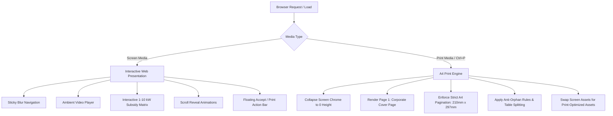

# Technical Specification Document (TECH_SPEC)
## DEVSON Renewable Energy Proposal, Pricing & Quotation Engine

---

## 1. System Overview & Architectural Approach

### 1.1 Architecture Pattern
The platform is designed as a **High-Performance Static Web Application with Embedded A4 Print Rendering Engine and Interactive Rooftop Solar Subsidy Calculator**.
It adheres strictly to the project guidelines:
- **Core:** Semantic HTML5 structure with modern ES6+ JavaScript and React 19 / Next.js 15 App Router.
- **Styling:** Modular Vanilla CSS utilizing CSS Custom Properties (Tokens) for maximum flexibility, zero build-step overhead, and pristine A4 print fidelity without CSS framework conflicts.
- **Asset Pipeline:** Localized static asset structure decoupling the proposal from external server dependencies and avoiding base64 HTML bloat.

### 1.2 Dual Rendering Pipeline


---

## 2. Directory & File Structure

```
Devson/
├── public/assets/
│   ├── logos/
│   │   ├── devson-logo.png           # High-res vector-quality Devson circular emblem
│   │   └── favicon.png               # Brand favicon
│   ├── clients-affiliations.png      # Bank & client affiliation composite
│   ├── phase.png                     # 20-step execution methodology graphic
│   ├── service.png                   # Screen-optimized service graphic
│   ├── services-pdf.png               # Print-optimized service graphic (A4 scaled)
│   ├── jhiganpur.png                 # Track record project photo (2 MW)
│   ├── khurai.png                    # Track record project photo (2 MW)
│   ├── raisen.png                    # Track record project photo (2 MW)
│   └── guna.png                      # Track record project photo (6 MW)
├── css/
│   ├── tokens.css                    # CSS variables: colors, fonts, shadows, metrics
│   ├── base.css                      # Reset, typography, layout container (.wrap)
│   ├── components.css                # Nav, Hero, Cards, Tables, Gantt, Modals
│   └── print.css                     # Dedicated A4 print media queries and pagination rules
├── js/
│   ├── main.js                       # IntersectionObserver, scroll triggers, mobile menu
│   └── print-engine.js               # Image preloading, iOS Safari detection, safePrint()
├── index.html                        # Main web application & quotation entry point
├── package.json                      # Local development scripts (dev server, linting)
├── PRD.md                            # Product Requirements Document
└── TECH_SPEC.md                      # Technical Specification Document
```

---

## 3. Design Tokens & Design System

### 3.1 Color Palette
```css
:root {
  /* Brand Primary & Backgrounds */
  --forest: #0B2818;          /* Deep corporate forest green */
  --forest-light: #153922;    /* Gradient midpoint */
  --forest-dark: #06160D;     /* Deep hero vignette */
  --paper: #FAF8F3;           /* Warm organic cream background */
  --slate: #1C2620;           /* Primary typography color */
  --white: #FFFFFF;           /* Card and print sheet background */

  /* Solar Accents & Highlights */
  --amber: #E8A33D;           /* Vibrant solar amber */
  --amber-deep: #C97F1E;      /* Rich dark amber for badges & borders */

  /* Neutral Supporting Tones */
  --sage: #E8EDE4;            /* Soft alternating section background */
  --sage-line: #CFDBC8;       /* Subtle card borders */
  --green-line: #2D5A3D;      /* Checkmark & accent lines */
  --muted: #6B7568;           /* Secondary body & caption text */

  /* Geometry & Metrics */
  --radius: 14px;
  --radius-sm: 8px;
  --radius-pill: 30px;
  --maxw: 980px;
}
```

### 3.2 Typography Tokens
```css
/* Google Fonts Import */
@import url('https://fonts.googleapis.com/css2?family=Space+Grotesk:wght@400;500;600;700&family=Inter:wght@400;500;600;700;800&display=swap');

/* Font Family Stack */
--font-display: 'Space Grotesk', -apple-system, BlinkMacSystemFont, 'Segoe UI', Roboto, sans-serif;
--font-body: 'Inter', -apple-system, BlinkMacSystemFont, 'Segoe UI', Roboto, sans-serif;
--font-mono: 'SFMono-Regular', Consolas, 'Liberation Mono', Menlo, Courier, monospace;
```

---

## 4. Component Technical Specifications

### 4.1 Sticky Navigation (`.nav`)
- **Structure:** Brand logo, desktop anchor links (`#summary`, `#specification`, `#scope`, `#schedule`, `#commercial`), CTA button, and mobile hamburger.
- **Glassmorphism:** `background: rgba(250, 248, 243, 0.92); backdrop-filter: blur(10px); border-bottom: 1px solid var(--sage-line);`
- **Mobile Responsive Drawer:** Activates on screens `< 768px`. Absolute full-width overlay with high-contrast menu items.

### 4.2 Hero Section with Autoplay Video (`.hero`)
- **Video Source:** Cloudinary streaming CDN with dual format support (`video/mp4` and `video/webm`) and low-res poster placeholder.
- **Overlay:** Dual-layer gradient + repeating angled micro-grid (`repeating-linear-gradient(115deg, rgba(255,255,255,0.025)...)`).
- **Hero Metrics Strip:** 4-column CSS Grid displaying:
  1. `12,500 KWp` (System DC Capacity)
  2. `10,000 KW` (Grid AC Export)
  3. `120 Days` (Turnkey Commissioning)
  4. `₹31.18 Cr` (Total Turnkey Investment)

### 4.3 Interactive Gantt Timeline (`.gantt`)
- **HTML Table Structure:** 19 activity rows with 6 sub-period cells corresponding to Phase 1 (Days 1–40), Phase 2 (Days 41–80), and Phase 3 (Days 81–120).
- **Styling:** Gradient progress bars (`.gbar.on { background: linear-gradient(135deg, var(--amber), var(--amber-deep)); }`).
- **Print Handling:** `min-width: 100%; overflow: visible !important;` to prevent clipped table edges in PDF.

### 4.4 Commercial Bill of Quantities (BOQ) Module
```typescript
interface BoqItem {
  id: number;
  description: string;
  specification: string;
  quantity: number;
  perWattRate: number;
  unitPrice: number;
  amount: number;
}
```
**Data Set & Calculations:**
| Description | Specification | Qty | Per Watt | Unit Price (₹) | Total Amount (₹) |
|---|---|---|---|---|---|
| Solar Module | 620 Wp Future Bi-facial | 20,161 | ₹14.25 | 8,835.00 | 17,81,22,435.00 |
| Inverter | 320 KVA Sungrow Central | 34 | ₹1.21 | 4,45,000.00 | 1,51,30,000.00 |
| Structure | HDGI Column & Galvanum Rafter | 200 | ₹1.68 | 1,05,000.00 | 2,10,00,000.00 |
| Cable AC | 300SQMM Armoured 11KV HT | 6,800 | ₹0.82 | 1,500.00 | 1,02,00,000.00 |
| Cable DC | 4 Sq.mm copper EN type | 52,075 | ₹0.23 | 56.00 | 29,16,200.00 |
| BOS | HDPE pipe, connectors, LA, earthing | 1 | ₹0.40 | 50,00,000.00 | 50,00,000.00 |
| ACDB (LT Panel) | 7 IN 2 OUT, L&T | 1 | ₹0.32 | 40,00,000.00 | 40,00,000.00 |
| Transformer | 33/0.8KV, 10000 KVA | 1 | ₹1.04 | 1,30,00,000.00 | 1,30,00,000.00 |
| HT Panel | 33KV, ABB Panel | 1 | ₹0.16 | 20,00,000.00 | 20,00,000.00 |
| GSS Meter | 3x ABT Meter 150 + metering eqpt. | 1 | ₹0.11 | 13,50,000.00 | 13,50,000.00 |
| Transmission Line | 33 KV Double Circuit | 3 | ₹0.36 | 15,00,000.00 | 45,00,000.00 |
| GSS Injection Bay | 33 KV Substation Bay | 1 | ₹0.08 | 10,00,000.00 | 10,00,000.00 |
| I&C incl. Civil | 12,500 KW installation & civil | 1 | ₹1.02 | 1,28,00,000.00 | 1,28,00,000.00 |
| EPCM | Engineering & Project Mgmt | 1 | ₹0.72 | 90,00,000.00 | 90,00,000.00 |
| Fencing | Chain link fencing, 10ft | 3,000 | ₹0.24 | 1,000.00 | 30,00,000.00 |
| Control Room | SCADA, CCTV, lighting | 1 | ₹0.26 | 33,00,000.00 | 33,00,000.00 |

- **Base Total:** `₹28,63,18,635.00`
- **GST Rate:** `8.9% composite EPC rate` -> `₹2,54,82,358.52`
- **Grand Total:** `₹31,18,00,993.52`
- **Effective Price per Watt:** `₹24.94 / Wp`

---

## 5. Print & PDF Optimization Engine

### 5.1 The Zero-Height Absolute Collapse Technique
On Chromium mobile and iOS Safari, applying `display: none` to the `.hero` element often leaves an empty phantom page between the Cover Page and Section 1 because the browser calculates layout bounds before applying media-specific overrides.
The solution implemented in `print.css`:
```css
@media print {
  .hero {
    display: block !important;
    position: absolute !important;
    top: 0 !important;
    left: 0 !important;
    height: 0 !important;
    max-height: 0 !important;
    overflow: hidden !important;
    visibility: hidden !important;
    pointer-events: none !important;
    margin: 0 !important;
    padding: 0 !important;
    border: none !important;
    break-before: avoid !important;
    break-after: avoid !important;
  }
}
```

### 5.2 Strict Section Page-Breaks & Anti-Orphan Rules
```css
@media print {
  @page {
    size: A4 portrait;
    margin: 0;
  }
  
  /* Every primary section forces a new page */
  section {
    padding: 10mm 7.5mm;
    page-break-before: always;
    break-before: page;
    page-break-inside: auto;
    break-inside: auto;
  }

  /* Exclude first section after hidden hero from double-breaking */
  section:first-of-type, #about {
    page-break-before: avoid !important;
    break-before: avoid !important;
  }

  /* Atomic units that must never split across sheets */
  .summary-card, .spec-item, .vendor-card, .warranty-card,
  .proj-card, .scope-block, tr, .total-banner {
    page-break-inside: avoid;
    break-inside: avoid;
  }

  /* Headings must never be isolated at the bottom of a page */
  h1, h2, h3, h4, .section-head, .scope-title {
    page-break-after: avoid;
    break-after: avoid;
  }
}
```

### 5.3 iOS Safari Print Guide Modal
Because iOS Safari cannot trigger a direct PDF download via `window.print()`, `print-engine.js` detects iOS user-agents:
```javascript
const isIOS = /iphone|ipad|ipod/i.test(navigator.userAgent) ||
  (navigator.platform === 'MacIntel' && navigator.maxTouchPoints > 1);

function safePrint() {
  makeAllVisible();
  if (isIOS) {
    showIOSPrintGuide();
    return;
  }
  waitForImages(() => {
    requestAnimationFrame(() => {
      requestAnimationFrame(() => {
        window.print();
      });
    });
  });
}
```

---

## 6. Security, Accessibility & Performance

### 6.1 Security Best Practices
- **No Insecure Protocol Calls:** All video assets loaded via secure HTTPS from Cloudinary; fonts from Google Fonts CDN.
- **No Execution Sinks:** Zero usage of `eval()`, `new Function()`, or dynamic `innerHTML` injections from untrusted origins.
- **Isolated Static Environment:** Eliminates SSR vulnerability vectors, remote code execution, and unauthenticated database exposure.

### 6.2 Accessibility (WCAG 2.1 AA)
- High contrast color combinations: `#0B2818` on `#FAF8F3` has a contrast ratio of `14.8:1` (exceeding AAA requirement of 7:1).
- Amber accents (`#C97F1E`) on white/cream have a contrast ratio of `4.6:1` (meeting AA requirement for UI controls and large text).
- Hamburger menu contains accessible attributes (`aria-label="Menu"`, focus states).
- Descriptive `alt` attributes on all technical illustrations and project photos.

---

## 7. Development & Verification Plan

### 7.1 Local Development Workflow
Run using a lightweight zero-dependency dev server:
```bash
# Option 1: Node http-server or live-server
npx -y serve ./ -l 3000

# Option 2: Python built-in server
python -m http.server 3000
```

### 7.2 Verification Checklist
1. **Asset Integrity:** Verify all 9 PNG files load from `assets/` with HTTP 200 (no 404s, no `localhost:3000` hardcoded references).
2. **Viewport & Responsiveness:** Test at 375px (iPhone SE), 768px (iPad Mini), 1024px (iPad Pro), and 1440px (Desktop).
3. **Print Emulation:** In Chrome DevTools, open More Tools -> Rendering -> Emulate CSS media type -> `print`. Verify:
   - Cover page displays as Page 1.
   - Hero video and navigation are invisible.
   - Commercial offer table summary and total banner remain glued on the same page.
   - Section 10 (Track Record) renders with project cards cleanly.
   - Total printed sheet count is 10–12 pages with zero blank pages.

---

## 8. Changelog
### 2026-10-24 — GitHub Repository Migration & Cloudflare Deployment Readiness
- Modified: Remote Git configuration, `package.json`, `wrangler.jsonc`, `out/` build artifacts.
- Before: Local repository was pointing to legacy remote `https://github.com/devvratyadav93/ASA-EPC-Pvt.-Ltd.git`.
- After:
  1. Configured git remote origin to the new official repository: `https://github.com/devvratyadav93/Devson-Renewable-Energy.git`.
  2. Executed clean production build (`npm run build`), generating 100% pre-rendered static assets in `./out` conforming to `wrangler.jsonc` assets specification.
  3. Committed 142 files (12,043 insertions) encompassing all 4 core routes, design tokens, modular stylesheets, bilingual dictionary, and custom synthesized assets.
  4. Pushed branch `main` to `origin/main` cleanly on GitHub, triggering/enabling Cloudflare Pages automated git deployment.
- Reason: User requested pushing the completed project into the newly created GitHub repository and deploying to Cloudflare.

### 2026-10-24 — Contact Page Office Directory Bottom Relocation & Location Image Cards
- Modified: `src/app/contact/page.tsx`, `src/styles/contact.css`, `scripts/generate_location_images.py`, `public/assets/offices/`.
- Before:
  1. The 3-card Office Directory was placed at the top of `/contact` immediately under the banner, forcing users to view corporate addresses before encountering the inquiry form or FAQ.
  2. The cards lacked visual photography, using small emoji icons (`🏛️`, `🏢`, `🏦`) in a flat grey square box.
- After:
  1. Re-architected `/contact` so that the Direct Inquiry Form sits prominently at the top, followed by `FaqSection`, and the Office Directory (`.contact-offices-section` with `#offices`) is positioned at the very bottom right above the global footer.
  2. Synthesized 3 high-resolution branded photographic headers via `scripts/generate_location_images.py`:
     - Rajgir Head Office: `/assets/offices/rajgir-head-office.jpg` (modern white corporate solar building with landscaped lawn, deep blue sky, and Devson 3D emblem).
     - Nawada Branch Office: `/assets/offices/nawada-branch-office.jpg` (modern executive client advisory and solar consultation lounge with Devson 3D emblem).
     - State Bank of India: `/assets/offices/sbi-banking-partner.jpg` (authentic SBI commercial branch with blue signage, ATM, and official SBI emblem).
  3. Upgraded `.contact-card` architecture with full-bleed media headers (`.contact-card-media` with `.contact-card-img` hover zoom), floating location badges (`.contact-badge-floating`), and padded card bodies (`.contact-card-content`).
- Reason: User requested moving the office location cards to the very bottom and attaching images for each location.

### 2026-10-24 — Contact & FAQ Page Modernization & Energy Needs Alignment Fix
- Modified: `src/styles/base.css`, `src/styles/energy-needs.css`, `src/app/contact/page.tsx`, `src/styles/contact.css`, `src/components/FaqSection.tsx`, `src/styles/faq.css`.
- Before:
  1. The Appliance Load & Capacity Estimator header in `EnergyNeedsSection` was misaligned/shifted to the left because `.section-head` had `max-width: 820px` without horizontal centering (`margin: 0 auto`), creating an offset relative to the centered 1380px table below it.
  2. The Contact & FAQ page (`/contact`) had rudimentary office cards lacking direct Google Maps navigation, an unstyled inquiry form with no interactive topic chips, and an FAQ section wrapped in a legacy dark `#081d12` container that clashed with the light luxury redesign across the rest of the site.
- After:
  1. In `src/styles/base.css` and `src/styles/energy-needs.css`, centered `.section-head.text-center` with explicit `margin: 0 auto 28px; max-width: 860px;`, ensuring pixel-perfect alignment of the eyebrow badge, title, subtitle, and tabs with the matrix table.
  2. Modernized `src/app/contact/page.tsx` and `src/styles/contact.css`: converted office directory cards to a clean light-neutral aesthetic with direct Google Maps links, phone/WhatsApp links, and structured monospace statutory rows. Upgraded the Direct Inquiry & Feasibility form with 4 interactive topic selector chips, focus rings, privacy disclaimer, and a solar amber CTA button.
  3. Overhauled `src/components/FaqSection.tsx` and `src/styles/faq.css`: converted from dark `#081d12` to a bright light-neutral `#F8FAF8` background with pure white `#FFFFFF` accordion question cards, emerald category pills, smooth CSS toggle animations, and a dedicated executive helpline banner.
- Reason: User requested fixing the misaligned component in the Load Estimator and comprehensively modernizing all sections of the Contact & FAQ page to match the professional light theme across the platform.

### 2026-10-22 — Navbar CTA: Replaced WhatsApp Icon with Corporate "Contact Us" Button
- Modified: `src/components/Navigation.tsx`, `src/components/Footer.tsx`, `src/translations/index.ts`, and `src/styles/globals.css`.
- Before: Main header navigation had a green WhatsApp pill button (`💬 WhatsApp`).
- After: Main header navigation features an amber-pill "Contact Us" CTA button (`#contact`) with a crisp SVG phone icon, smooth scroll anchoring to `<footer id="contact">`, localized copy ("Contact Us" in EN, "संपर्क करें" in HI), and responsive visibility in both desktop header and mobile slide-out menu. WhatsApp continues to be accessible via the persistent floating side dock.
- Reason: User requested to replace navbar's WhatsApp icon with Contact Us button to enhance corporate presentation while keeping WhatsApp readily available across all viewport positions.

### 2026-10-22 — Rayzon Solar & Waaree Shop Redesign (Frosted Navbar, Energy Needs Matrix, Spotlight Cards & FAQ)
- Modified: `src/components/Navigation.tsx`, `src/components/Hero.tsx`, `src/components/EnergyNeedsSection.tsx` (new), `src/components/FaqSection.tsx` (new), `src/components/FloatingDock.tsx` (new), `src/app/page.tsx`, `src/translations/index.ts`, and `src/styles/globals.css`.
- Before: Platform was laid out as an ultra-long quotation document without load estimation, FAQ, or quick-action dock.
- After: Complete tier-1 solar portal synthesis:
  1. Rayzon Solar style frosted glassmorphism sticky navigation bar with 6 core links.
  2. 4 Hero Spotlight floating cards anchored at the base of the Hero section.
  3. Waaree style "Know Your Solar Energy Needs" appliance load matrix with Residential & Commercial tabs, live load calculations, and automated system sizing recommendation linked to the Subsidy Engine.
  4. Waaree style floating side dock with yellow calculator jump button, quote shortcut, and floating WhatsApp bubble.
  5. Interactive, categorized bilingual FAQ Accordion with live filters.
- Reason: User requested to adopt best-in-class components and presentation styles from `shop.waaree.com` and `rayzonsolar.com`.

### 2026-10-22 — Streamlined Navigation, Compact Globe Language Switcher & 4-Column Footer Architecture
- Modified: `src/components/Navigation.tsx`, `src/components/Footer.tsx`, `src/styles/globals.css`, and `src/translations/index.ts`.
- Before: Top navigation bar was overcrowded with 6 links + dual-pill language switch + 2 CTA buttons (WhatsApp & Call Us), causing visual crowding; footer had 3 columns lacking proposal section anchors.
### 2026-10-24 — Energy Needs Route Pruning & Microsoft Forms Quotation Architecture
- Modified: `src/app/energy-needs/page.tsx`, `src/translations/index.ts`, `src/components/GetQuotationSection.tsx`, and `src/styles/get-quotation.css`.
- Before:
  1. `TemplateDownloadCard` was mounted at the base of `/energy-needs`.
  2. Quotation badge was labeled "GET INSTANT SOLAR QUOTATION".
  3. Form was structured as a basic card with generic form inputs.
- After:
  1. Removed `TemplateDownloadCard` from `/energy-needs` (preserved strictly on `/`).
  2. Renamed quotation badge to "Get Quotation" (`t.badge`).
  3. Re-architected form into Microsoft Forms enterprise layout: top gradient stripe (`.ms-form-accent-strip`), form header metadata badges (`⏱️ ~2 min`, `🏢 Official DEVSON Proposal`, `🔒 SSL Encrypted`, `* Required`), numbered section headers (`Section 1: Applicant & Contact Details`, `Section 2: Solar Requirement & Scheme`, `Section 3: Remarks`), individual numbered question blocks (`1.`, `2.`, `3.`, ...), tactile choice chips for rapid capacity/bill/area selection, MS Forms underline focus inputs, and compliance footer.
- Reason: User requested removing the pricing schedule dossier from Energy Needs page, renaming badge to "Get Quotation", and styling the quotation form like Microsoft Forms.

### 2026-10-24 — Appliance Matrix Theme Isolation & Zero-Scroll 10-Column Table Auto-Fit
- Modified: `src/styles/energy-needs.css`, `src/styles/rooftop-subsidy.css`, and `src/translations/index.ts`.
- Before:
  1. `.table-responsive` had an unscoped `background: #FFFFFF` rule in `rooftop-subsidy.css`, which turned the dark Appliance Matrix table in `EnergyNeedsSection` into an opaque white box with white text on white background (invisible).
  2. `.subsidy-data-table` had hardcoded `min-width: 1020px` and `white-space: nowrap` on all headers, forcing the table to overflow on standard 1024px–1280px laptop screens and cutting off the 10th "Action" / "Select" column.
- After:
  1. Scoped `.table-responsive` white background strictly to `.subsidy-table-section .table-responsive`, and reinforced `.energy-matrix-card` with an explicit solid dark `#081E12` background, pure white bold text (`#FFFFFF`), amber ratings, and dark translucent input pills (`rgba(0,0,0,0.4)`).
  2. Removed `min-width: 1020px` from `.subsidy-data-table`, switched header text to `white-space: normal; line-height: 1.25;`, reduced cell padding to `10px 5px`, streamlined Hindi header text (`शुद्ध देय (₹)`), and optimized button padding so all 10 columns fit within ~680px minimum width, eliminating horizontal scrollbars across all laptop and desktop monitors.
- Reason: User reported that the first table was not visible and the second table required horizontal scrolling to see all columns.

### 2026-10-24 — Widescreen Container Architecture (1340px) & 10-Column Subsidy Schedule Table Optimization
- Modified: `src/styles/tokens.css`, `src/styles/base.css`, `src/styles/navigation.css`, `src/styles/rooftop-subsidy.css`, and `src/components/RooftopSubsidySection.tsx`.
- Before: Container token `--maxw` was set to 980px, creating cramped page layouts on modern displays and hiding 4-5 table columns behind horizontal scrolling. Table cells lacked semantic column classes and granular alignment rules.
- After:
  1. Updated `--maxw` to 1340px in `tokens.css` and added fluid clamp padding `padding: 0 clamp(20px, 2.5vw, 32px)` in `base.css` and `navigation.css`.
  2. Redesigned table layout in `rooftop-subsidy.css` with semantic classes (`th-cap`, `th-daily`, `th-monthly`, `th-area`, `th-cost`, `th-central`, `th-state`, `th-subsidy`, `th-net`, `th-action`) and corresponding `td` classes.
  3. Formatted financial figures with `font-variant-numeric: tabular-nums`, right-aligned monetary values, center-aligned generation/area metrics, and left-aligned capacity badges.
  4. Adjusted table padding to `12px 10px` so all 10 columns fit comfortably on desktop screens without clipping or horizontal scrolling, while preserving smooth touch-scrolling on tablet/mobile (< 1080px).
- Reason: User requested utilization of full website width across all pages and full visibility of all 10 table columns for seamless option selection.

### 2026-10-24 — Subsidy Schedule Table Styling & Capacity Badge Overlap Fix
- Modified: `src/styles/rooftop-subsidy.css`.
- Before: `<table className="subsidy-data-table">` lacked styling rules due to legacy class names (`.subsidy-tbl` vs `.subsidy-data-table`), displaying raw unstyled browser tables. The `.cap-popular` badge on the 3 kW selector pill wrapped onto two lines and overlapped the "3 kW" label.
- After:
  1. Implemented complete CSS styling for `.subsidy-data-table`, `.table-responsive`, `.sts-head`, `.sts-toggle-btn`, `.th-net`, `.td-net`, `.table-select-btn`, and row hover/selected states.
  2. Fixed `.cap-popular` with `top: -12px; left: 50%; transform: translateX(-50%); white-space: nowrap;` and added `padding-top: 14px` on `.capacity-pills`, ensuring zero overlap and clean floating badge alignment.
- Reason: User requested styling for the raw table and resolution of the overlapping badge.

### 2026-10-24 — Hero Highlights & Spotlight Extraction into Dedicated Home Section
- Modified: `src/components/Hero.tsx`, `src/components/HomeHighlightsSection.tsx` (new), `src/styles/home-highlights.css` (new), `src/styles/globals.css`, `src/styles/hero.css`, `src/app/page.tsx`.
- Before: The 4 metric statistics (`hero-stats`) and 4 spotlight cards (`hero-spotlight-bar`) were embedded inside `Hero.tsx`, covering the background GIF and crowding the viewport.
- After:
  1. Built `HomeHighlightsSection.tsx` containing the 4 key metrics and 4 spotlight navigation cards.
  2. Created `src/styles/home-highlights.css` providing an executive light-neutral canvas (`#F4F6F4`) with dedicated `.h-stat-card` and `.h-spotlight-card` styles, hover elevation, and gradient top borders.
  3. Added `@import './home-highlights.css';` to `src/styles/globals.css`.
  4. Mounted `<HomeHighlightsSection />` directly below `<Hero />` in `src/app/page.tsx` on the Home page only.
  5. Updated `Hero.tsx` with clean CTA buttons (`btn-hero-primary` and `btn-hero-secondary`), reducing bottom padding from 120px to 75px for a breathable, cinematic hero experience.
- Reason: User requested extracting the stats and spotlight cards out of the Hero into their own separate, professional section just below the Hero on the Home page only.

### 2026-10-24 — Hero GIF Re-Synthesis: Steady 4.8s Left-to-Right Panning Tracking Shot
- Modified: `public/assets/solar-hero-loop.gif`, `assets/solar-hero-loop.gif`.
- Before: The synthesized GIF incorporated a camera zoom in/out oscillating pulse.
- After:
  1. Completely eliminated all zoom scaling (`zoom = 1.0` constant).
  2. Implemented a steady horizontal tracking camera motion sliding from left to right (`x = 0` to `x = 203` offset) across the 1376x768 base image.
  3. Extended duration to 4.83 seconds (46 frames at 105ms delay).
  4. Added an 8-frame crossfade blend at the cycle tail so the loop from right back to left is imperceptible and continuous.
- Reason: User requested removing the zooming effect and implementing a slow left-to-right motion lasting 4-5 seconds.

### 2026-10-24 — Custom High-Fidelity Solar Hero GIF Creation & Radial Ambient Overlay
- Modified: `public/assets/solar-hero-loop.gif`, `assets/solar-hero-loop.gif`, `src/styles/hero.css`.
- Before: The Hero background utilized a low-resolution 480x270 dithered GIF with visible color banding and artifacting, overlaid with a flat dark background.
- After:
  1. Engineered a custom high-definition 960x535 looping animated GIF (`solar-hero-loop.gif`) featuring a modern commercial and residential rooftop solar panel installation at golden sunrise.
  2. Implemented 28 seamlessly looped frames with smooth cosine camera drift, dynamic sun flare pulsation, and sweeping light glints across the solar cell grid.
  3. Replaced `.hero-video-overlay` in `src/styles/hero.css` with a tuned radial gradient (`radial-gradient(ellipse at 35% 25%, rgba(6, 22, 13, 0.45) 0%, rgba(6, 22, 13, 0.72) 60%, rgba(6, 22, 13, 0.82) 100%)`) providing clear visibility of the sunrise and solar array while ensuring white hero typography passes WCAG 2.1 AA legibility.
- Reason: User requested a custom-created, modern, and professional replacement for the Home page hero GIF.

### 2026-10-24 — GIF Media Replacement & Track Record / Our Network Animated Overhaul
- Modified: `src/components/Hero.tsx`, `src/components/AboutSection.tsx`, `src/components/TrackRecordSection.tsx`, `src/components/ClientsNetworkSection.tsx`, `src/styles/track-record.css`, `src/styles/about.css`, `public/assets/`.
- Before: External Cloudinary video streaming used in Hero and About sections. Track Record was a static text pill list and flat project photo grid. Our Network was an unstyled static image block.
- After:
  1. Ingested `solar-hero-loop.gif` (widescreen 480x270) and `solar-energy-animation.gif` (square 480x480) from `Supporting Documents` into `public/assets/` and `assets/`.
  2. Updated `Hero.tsx` to render `solar-hero-loop.gif` directly under the hero gradient overlay, removing external CDN video requests.
  3. Replaced duplicate About video player with `AboutSection.tsx` Clean Energy Generation showcase card powered by `solar-energy-animation.gif` with technical metrics pills.
  4. Transformed `TrackRecordSection.tsx` with:
     - Continuous infinite horizontal scrolling partner marquee (`@keyframes marqueeScroll`) with pause-on-hover and bilateral frosted edge masks.
     - Live impact metrics ticker bar (12+ MWp pipeline, 250+ sites, 99.2% uptime, 30 days commissioning).
     - Interactive commissioned project cards with live status indicators (`🟢 Commissioned & Grid-Tied`), hover zoom, and modal technical specification inspect dialog.
  5. Modernized `ClientsNetworkSection.tsx` with categorized partner tabs (Banking, Technology, DISCOMs) and an animated laser scanning beam (`@keyframes scanBeam`) over the verified affiliations matrix.
- Reason: User requested replacing existing GIFs with the two new GIFs from Supporting Documents, and modifying Track Record and Our Network sections for a more professional look with animations.

### 2026-10-24 — Contact Page Quick Inquiry Form Redesign & Styling Architecture
- Modified: `src/app/contact/page.tsx`, `src/styles/contact.css`.
- Before: `.form-input` and `.form-textarea` classes in `src/styles/contact.css` had zero styling rules defined. Browsers rendered raw inline HTML controls with tiny textarea boxes (cols=20) and placed the submit button inline right next to the textarea. Form fields lacked explicit accessibility `<label>` tags.
- After:
  1. Re-structured `src/app/contact/page.tsx` with dedicated `.form-group` wrappers, explicit semantic `<label>`s, and descriptive placeholder prompts.
  2. Integrated one-click topic chips allowing users to quickly append inquiry themes (*PM Surya Ghar (1-3 kW)*, *Site Feasibility Survey*, *Commercial Net Metering*, *PM-KUSUM Agri Pump*).
  3. Added comprehensive CSS styling in `src/styles/contact.css` for `.quick-inquiry-box`, `.inquiry-badge`, `.form-label`, `.form-input`, `.form-textarea`, `.inquiry-chip`, and `.inquiry-actions-row`.
  4. Implemented full-width vertical-resizable textarea (`min-height: 110px`), brand focus rings (`box-shadow: 0 0 0 3px rgba(11, 40, 24, 0.12)`), privacy note, and responsive stacking for mobile devices.
- Reason: User requested fixing the unstyled Quick Message section on the Contact page.

### 2026-10-24 — Template Card Removal from Energy Needs & MS Forms Quotation Redesign
- Modified: `src/app/energy-needs/page.tsx`, `src/translations/index.ts`, `src/components/GetQuotationSection.tsx`, `src/styles/get-quotation.css`.
- Before: `TemplateDownloadCard` was mounted on `/energy-needs`, duplicating the flyer section. The Quotation badge was labeled "GET INSTANT SOLAR QUOTATION", and the quotation form utilized a basic card layout with generic inputs.
- After:
  1. Removed `TemplateDownloadCard` from `/energy-needs` (`src/app/energy-needs/page.tsx`), keeping it exclusively on `/`.
  2. Updated quotation section badge to "Get Quotation" in English and "कोटेशन प्राप्त करें" in Hindi in `src/translations/index.ts`.
  3. Re-architected `GetQuotationSection.tsx` into a Microsoft Forms enterprise aesthetic (`.ms-form-shell`):
     - Added corporate gradient accent top stripe and official metadata bar (time-to-complete, SSL encrypted, required fields notice).
     - Structured into 3 numbered sections: *Applicant & Contact Details*, *Solar Capacity & Subsidy Scheme*, *Property Specifications & Remarks*.
     - Numbered every question block (1 to 8) with distinct question pills and labels.
     - Added interactive Microsoft Forms choice chips for rapid single-click capacity, monthly bill, and roof area selection.
     - Implemented classic MS Forms input styling with 2px gold focus underline and elevated question card focus states.
     - Enhanced submission footer with formal security disclaimer and loading button state.


### 2026-10-24 — Section 4 Simulator Widget Removal & Reuploaded Campaign Photo 2-Column Split
- Modified:
  1. `src/components/HomeCalculatorTeaser.tsx`: Removed the right-hand `Live Solar Subsidy Estimator` simulator widget card and state (`previewTiers`, `selectedKw`, `formatINR`). Embedded the reuploaded high-resolution photo (`/assets/pm-surya-ghar-30-lakh-homes.jpg`).
  2. `src/styles/home-calculator-teaser.css`: Overhauled to an expansive 2-column grid (`1.15fr 0.85fr`): left side houses the value proposition, verified subsidy points, and navigation buttons; right side displays the official 30 Lakh Homes campaign creative in a clean, elevated frame (`max-width: 480px`).
- Reason: User requested removing the simulator widget component from this section and arranging the reuploaded image properly so that the left text and right photo are clearly visible without crowding.

### 2026-10-24 — About Us Page Overhaul & Light Theme Transformation
- Modified: `src/app/about/page.tsx`, `src/components/AboutSection.tsx`, `src/styles/about.css`, and `public/assets/values/` directory.
- Before:
  1. `src/app/about/page.tsx` included `ClientsNetworkSection` ("VALUABLE NETWORK").
  2. The `.summary-card` had no defined stylesheet rules, rendering credentials and legal details as an unformatted raw text dump.
  3. The startup callout banner, Mission card, and solar energy animation showcase all had dark forest green gradient backgrounds.
  4. "Our Core Values" was a basic row of 5 plain text buttons without imagery or explanatory context.
- After:
  1. Removed `ClientsNetworkSection` from `src/app/about/page.tsx`.
  2. Rebuilt `.summary-card` in `about.css` as a formal corporate credentials dossier with header emblem, alternating key-value rows with monospace identifiers, and verification badges (`✓ MCA Registered`, `✓ GSTIN Verified`, `✓ NBPDCL / SBPDCL Liaison`).
  3. Replaced the alert-style callout box with a 4-badge Institutional Trust & Compliance Strip (`Bihar Registered Startup`, `PM Surya Ghar & BREDA`, `DISCOM Net-Metering`, `Tier-1 ALMM Panels`), and eliminated all dark backgrounds across Mission card and animated solar showcase.
  4. Rebuilt "Our Core Values" into 5 rich photographic cards utilizing assets in `public/assets/values/` (`transparency.jpg`, `hardware.jpg`, `customer.jpg`, `accountability.jpg`, `sustainability.jpg`) with floating step pills, bold titles, and bilingual descriptions.
- Reason: User requested professional presentation without dark background components, photographic core values, and removal of the Valuable Network section.

### 2026-10-24 — Energy Needs & Schemes Page Overhaul & Light Theme Transformation
- Modified: `src/components/DetailedSchemesSection.tsx` (new), `src/styles/detailed-schemes.css` (new), `src/styles/globals.css`, `src/app/energy-needs/page.tsx`, `src/styles/energy-needs.css`, `src/components/RooftopSubsidySection.tsx`, and `src/styles/rooftop-subsidy.css`.
- Before:
  1. Section 1 on `/energy-needs` re-used `<GovernmentSchemesSection />`, producing visual duplication of the home-page rotator with PM Modi's photo.
  2. Section 2 (`EnergyNeedsSection`) used dark forest background `#06180E` and dark green cards `#081E12`, resulting in near-zero contrast for eyebrow badges and headers.
  3. Section 3 (`RooftopSubsidySection`) had a dark forest background on `.subsidy-calc-card` and flat emoji icons (`🏠`, `🏪`, `🏭`, `🌾`) on the 4 application sector cards.
- After:
  1. Built `DetailedSchemesSection.tsx` presenting an interactive 4-tab dossier detailing PM Surya Ghar, Bihar State Subsidy, PM-KUSUM Agri, and Commercial & MSME solar schemes with dedicated photographic references, ₹ subsidy breakdowns, verified benefits, eligibility checklists, and comparative matrix.
  2. Overhauled `energy-needs.css` to a clean light theme (`#F8FAF8`), white card `#FFFFFF`, emerald badge `#E8F5E9`, high-contrast forest green typography (`#0B2818`), and emerald summary banner.
  3. Overhauled `.subsidy-calc-card` in `rooftop-subsidy.css` to a clean white card with subtle border and crisp metrics; upgraded the 4 application sector cards with 4 high-resolution sector photos (`/assets/sectors/*.jpg`), category chips, verified perks, and direct quote CTAs.
- Reason: User requested comprehensive scheme explanations with photos, removal of all dark backgrounds causing illegibility in sections 2 & 3, and rich photographic cards for all 4 application sectors.

### 2026-10-24 — Authentic PM Modi Photo, 30 Lakh Homes Poster & Scheme Tabs Removal
- Modified:
  1. `src/components/GovernmentSchemesSection.tsx`: Replaced leadership image with `/assets/pm-modi-solar.webp` (authentic official photo of Hon'ble PM Narendra Modi). Removed the clunky top `.scheme-tabs-nav` button bar.
  2. `src/styles/government-schemes.css`: Cleaned up `.scheme-tabs-nav` and `.tab-progress-line` styles, allowing `.active-scheme-card` to cleanly expand to full height.
  3. `src/components/HomeCalculatorTeaser.tsx` & `src/styles/home-calculator-teaser.css`: Added center milestone poster column featuring `/assets/pm-surya-ghar-30-lakh-homes.webp` (*30 Lakh Homes Illuminated Under PM Surya Ghar Muft Bijli Yojana*), transitioning the teaser into a balanced 3-part layout (Value Proposition → National Milestone → Live Simulator).
- Reason: User requested replacing the leadership photo with their provided official PM Modi webp photo, removing the top scheme tab pills that cluttered Section 3, and incorporating the 30 Lakh Homes campaign poster on the Home page.

### 2026-10-24 — Home Page Six Section Visual & Layout Refinements
- Modified:
  1. `src/styles/hero.css`: Applied viewport height containment (`min-height: calc(100svh - 74px)`) with responsive `vh`/`vw` fluid clamps for titles, margins, and CTAs, ensuring all components are 100% visible on screen without cut-off.
  2. `src/components/HomeHighlightsSection.tsx` & `src/styles/home-highlights.css`: Integrated 4 photographic thumbnail headers (`spotlight-pm-surya-ghar.jpg`, `spotlight-get-quotation.jpg`, `spotlight-almm-panels.jpg`, `spotlight-bihar-team.jpg`) with hover scale transition and top category badges.
  3. `src/components/GovernmentSchemesSection.tsx` & `src/styles/government-schemes.css`: Transformed from a static 4-card grid into a 2-column split layout with an auto-cycling scheme rotator on the left (4.5s intervals, pause-on-hover, quick tab navigation) and an official national leadership photo card (`pm-surya-ghar-leadership.jpg`) on the right.
  4. `src/components/TemplateDownloadCard.tsx` & `src/styles/template-download.css`: Switched background from `#0B1E13` to light-neutral theme (`#F4F6F4`), expanded the flyer mockup to 57% of width, and reduced redundant body copy to punchy bullet points.
  5. `src/components/TrackRecordSection.tsx` & `src/styles/track-record.css`: Replaced text chips with 16 extracted corporate client and banking partner logos (`public/assets/logos/clients/*.png`).
  6. `src/app/page.tsx`: Removed redundant Section 7 (`ClientsNetworkSection`).
- Reason: User requested direct refinements to home page screen containment, visual richness, authoritative governmental presence, flyer prominence, and client logo consolidation.

### 2026-10-24 — CSS Architecture Modularization & Webpack Cache Resolution
- Modified: `src/styles/` directory: decomposed monolithic `globals.css` into 15 domain stylesheets (`tokens.css`, `base.css`, `navigation.css`, `hero.css`, `government-schemes.css`, `home-calculator-teaser.css`, `template-download.css`, `rooftop-subsidy.css`, `energy-needs.css`, `get-quotation.css`, `about.css`, `faq.css`, `track-record.css`, `contact.css`, `footer.css`, `floating-dock.css`).
- Before: All ~4,300 lines of CSS were housed in a single monolithic `globals.css` file. A single CSS syntax issue or vendor prefix warning had the potential to break the cascading stylesheet for the entire website. Furthermore, running `npm run build` during an active `npm run dev` session left `.next` with corrupted production chunks, causing runtime `Cannot find module './611.js'`.
- After:
  1. Each domain/feature now has its own isolated stylesheet (< 250 lines each).
  2. `globals.css` acts as a clean master index importing all domain files in order.
  3. Purged `.next` corrupted build cache and restarted the development server.
- Reason: User requested architectural isolation of CSS to eliminate single-point-of-failure risks and requested resolution of the runtime module lookup failure.

### 2026-10-24 — Home Interactive Teaser Component & Pricing Dossier Redesign
- Modified: `src/components/HomeCalculatorTeaser.tsx` (new), `src/components/TemplateDownloadCard.tsx`, `src/styles/globals.css`, `src/app/page.tsx`, `src/app/about/page.tsx`, `src/app/contact/page.tsx`, and `src/app/not-found.tsx` (new).
- Before: The Home page stacked two virtually identical dark-green rounded boxes with amber borders (`home-cta-banner` and `TemplateDownloadCard`). Furthermore, `TemplateDownloadCard` was mounted across all subpages (`/`, `/about`, `/contact`, `/energy-needs`).
- After:
  1. Replaced the generic CTA banner on `/` with `HomeCalculatorTeaser.tsx` — an interactive split light-luxury card featuring live 1 kW to 10 kW sizing toggle buttons with real-time recalculations for net payable cost, subsidy amount, monthly generation units, and roof area.
  2. Redesigned `TemplateDownloadCard.tsx` into a certified executive document dossier (`DEVSON-SCH-2026-BR`) with gold security ribbon header, document metadata tags, and framed 3D document mockup with zoom hover.
  3. Scoped `TemplateDownloadCard` strictly to `/` and `/energy-needs` (removed completely from `/about` and `/contact`).
  4. Added `src/app/not-found.tsx` to satisfy Next.js static export compilation.
- Reason: User requested distinct, professional appearances for the two Home page components and strict restriction of the pricing schedule download to Home and Energy Needs pages only.

### 2026-10-24 — Next.js Multi-Page App Router Architecture & Quotation Engine
- Modified: App Router structure (`src/app/`), components (`src/components/`), and global layout (`src/app/layout.tsx`).
- Before: Monolithic single-page application with anchor-hash scrolling and unmounted legacy D K Builders 12.5 MWp proposal components.
- After: True 4-page Next.js App Router architecture (`/`, `/energy-needs`, `/about`, `/contact`). Elevated `LanguageProvider`, `Navigation`, `Footer`, and `FloatingDock` to `layout.tsx` for cross-page persistence. Added `GovernmentSchemesSection.tsx`, `GetQuotationSection.tsx` (lead capture with dual-notification confirmation), and `TemplateDownloadCard.tsx` (linking to `/assets/devson-flyer.png`). Removed all D K Builders and Bhopal/MP references; restricted brand strictly to Bihar.
- Reason: User requested multi-page transition, consolidation of all calculators into Energy Needs, honest startup positioning, and removal of client-specific tender content.

### 2026-10-22 — Single-Language Internationalization Architecture (EN | हिन्दी Toggle)
- Modified: Added `src/context/LanguageContext.tsx` and `src/translations/index.ts`.
- Before: Components had mixed English and Hindi text in the same views.
- After: Pure single-language experience at a time on entire site. Visitors can toggle between 100% pure English and 100% pure Hindi with instant reactivity and localStorage persistence.
- Reason: User requested single language at a time across the entire website.

### 2026-10-22 — Rebranding to Devson Renewable Energy & Rooftop Subsidy Engine
- Modified: Brand assets, package configuration, statutory credentials, and component tree.
- Before: Platform branded for ASA EPC Pvt. Ltd. (Bhopal) with single 12.5 MWp BOQ.
- After: Rebranded to DEVSON Renewable Energy Private Limited (Rajgir/Nawada, Bihar; CIN: U35105BR2026PTC087766, GSTIN: 10AANCD0450H1Z5). Added new official circular 3D logo, updated contact channels (WhatsApp: +91 92969 50833, Phone: +91 99730 50833), and created `RooftopSubsidySection.tsx` interactive 1–10 kW subsidy pricing engine.
- Reason: Client corporate entity registration confirmed and supporting documents provided.

### 2026-10-20 — Cloudflare Workers CI Build Succeeded
- Modified: Lockfile & Cloudflare Deployment Configuration
- Before: GitHub commit check failed with `npm ci` lockfile mismatch error.
- After: Synchronized `package-lock.json` with `package.json` (`commit e32e4cc`), resulting in `conclusion: "success"` on Cloudflare Workers Builds CI (`Version ID: d5688564-83ba-4210-a666-109c8ec2dff5`).
- Reason: Resolved dependency discrepancy so Cloudflare's `npm clean-install` runs cleanly.

### 2026-10-20 — Cloudflare Static Assets Deployment Configuration
- Modified: Cloudflare Deployment Configuration (`wrangler.jsonc`, `next.config.mjs`, `package.json`)
- Before: Unconfigured Cloudflare environment triggered `@opennextjs/cloudflare migrate` during `wrangler deploy`, creating a broken `WORKER_SELF_REFERENCE` binding to `asa-epc-quotation` (Error code: 10143).
- After: Configured `output: 'export'` in `next.config.mjs`, aligned package name to `asa-epc-pvt--ltd`, and created `wrangler.jsonc` specifying assets directory `./out`. Tested with dry-run verification.
- Reason: Eliminates unnecessary SSR OpenNext shims for a pure static presentation website, enabling instantaneous global CDN edge delivery without service binding errors.

### 2026-10-20 — Implementation in Next.js 15 App Router
- Modified: Application Architecture and Component Structure
- Before: Proposed Vanilla static web application with flat files.
- After: Implemented full modular Next.js 15 TypeScript project with App Router, modular React components (`src/components/`), localized static assets (`public/assets/`), and decoupled Vanilla CSS (`src/styles/`).
- Reason: User requested Next.js framework build ready for local `npm run dev` review and Cloudflare deployment.

### 2026-10-20 — Initial Technical Specification
- Modified: Architecture, Design Tokens, BOQ, Print Engine, and Asset Pipeline.
- Before: Not specified.
- After: Full comprehensive Technical Specification established.
- Reason: Engineering blueprint for duplicate website implementation.
