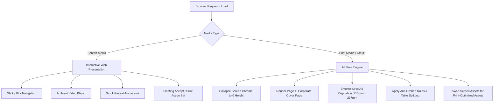

# Technical Specification Document (TECH_SPEC)
## ASA EPC Turnkey Solar Proposal & Quotation Engine

---

## 1. System Overview & Architectural Approach

### 1.1 Architecture Pattern
The platform is designed as a **High-Performance Static Web Application with Embedded A4 Print Rendering Engine**.
It adheres strictly to the project guidelines:
- **Core:** Semantic HTML5 structure with modern ES6+ JavaScript.
- **Styling:** Modular Vanilla CSS utilizing CSS Custom Properties (Tokens) for maximum flexibility, zero build-step overhead, and pristine A4 print fidelity without CSS framework conflicts.
- **Asset Pipeline:** Localized static asset structure decoupling the proposal from any brittle local development servers (`http://localhost:3000`) and avoiding 10MB base64 HTML bloat.

### 1.2 Dual Rendering Pipeline


---

## 2. Directory & File Structure

```
ASA EPC Pvt. Ltd/
├── assets/
│   ├── logos/
│   │   └── asa-epc-logo.png          # High-res vector-quality ASA EPC & Waaree Franchise logo
│   ├── clients-affiliations.png      # Bank & client affiliation composite
│   ├── phase.png                     # 20-step execution methodology graphic
│   ├── service.png                   # Screen-optimized service graphic
│   ├── services-pdf.png               # Print-optimized service graphic (A4 scaled)
│   ├── jhiganpur.png                 # Track record project photo (2 MW)
│   ├── khurai.png                    # Track record project photo (2 MW)
│   ├── raisen.png                    # Track record project photo (2 MW)
│   └── guna.png                      # Track record project photo (6 MW)
├── css/
│   ├── tokens.css                    # CSS variables: colors, fonts, shadows, metrics
│   ├── base.css                      # Reset, typography, layout container (.wrap)
│   ├── components.css                # Nav, Hero, Cards, Tables, Gantt, Modals
│   └── print.css                     # Dedicated A4 print media queries and pagination rules
├── js/
│   ├── main.js                       # IntersectionObserver, scroll triggers, mobile menu
│   └── print-engine.js               # Image preloading, iOS Safari detection, safePrint()
├── index.html                        # Main web application & quotation entry point
├── package.json                      # Local development scripts (dev server, linting)
├── PRD.md                            # Product Requirements Document
└── TECH_SPEC.md                      # Technical Specification Document
```

---

## 3. Design Tokens & Design System

### 3.1 Color Palette
```css
:root {
  /* Brand Primary & Backgrounds */
  --forest: #0B2818;          /* Deep corporate forest green */
  --forest-light: #153922;    /* Gradient midpoint */
  --forest-dark: #06160D;     /* Deep hero vignette */
  --paper: #FAF8F3;           /* Warm organic cream background */
  --slate: #1C2620;           /* Primary typography color */
  --white: #FFFFFF;           /* Card and print sheet background */

  /* Solar Accents & Highlights */
  --amber: #E8A33D;           /* Vibrant solar amber */
  --amber-deep: #C97F1E;      /* Rich dark amber for badges & borders */

  /* Neutral Supporting Tones */
  --sage: #E8EDE4;            /* Soft alternating section background */
  --sage-line: #CFDBC8;       /* Subtle card borders */
  --green-line: #2D5A3D;      /* Checkmark & accent lines */
  --muted: #6B7568;           /* Secondary body & caption text */

  /* Geometry & Metrics */
  --radius: 14px;
  --radius-sm: 8px;
  --radius-pill: 30px;
  --maxw: 980px;
}
```

### 3.2 Typography Tokens
```css
/* Google Fonts Import */
@import url('https://fonts.googleapis.com/css2?family=Space+Grotesk:wght@400;500;600;700&family=Inter:wght@400;500;600;700;800&display=swap');

/* Font Family Stack */
--font-display: 'Space Grotesk', -apple-system, BlinkMacSystemFont, 'Segoe UI', Roboto, sans-serif;
--font-body: 'Inter', -apple-system, BlinkMacSystemFont, 'Segoe UI', Roboto, sans-serif;
--font-mono: 'SFMono-Regular', Consolas, 'Liberation Mono', Menlo, Courier, monospace;
```

---

## 4. Component Technical Specifications

### 4.1 Sticky Navigation (`.nav`)
- **Structure:** Brand logo, desktop anchor links (`#summary`, `#specification`, `#scope`, `#schedule`, `#commercial`), CTA button, and mobile hamburger.
- **Glassmorphism:** `background: rgba(250, 248, 243, 0.92); backdrop-filter: blur(10px); border-bottom: 1px solid var(--sage-line);`
- **Mobile Responsive Drawer:** Activates on screens `< 768px`. Absolute full-width overlay with high-contrast menu items.

### 4.2 Hero Section with Autoplay Video (`.hero`)
- **Video Source:** Cloudinary streaming CDN with dual format support (`video/mp4` and `video/webm`) and low-res poster placeholder.
- **Overlay:** Dual-layer gradient + repeating angled micro-grid (`repeating-linear-gradient(115deg, rgba(255,255,255,0.025)...)`).
- **Hero Metrics Strip:** 4-column CSS Grid displaying:
  1. `12,500 KWp` (System DC Capacity)
  2. `10,000 KW` (Grid AC Export)
  3. `120 Days` (Turnkey Commissioning)
  4. `₹31.18 Cr` (Total Turnkey Investment)

### 4.3 Interactive Gantt Timeline (`.gantt`)
- **HTML Table Structure:** 19 activity rows with 6 sub-period cells corresponding to Phase 1 (Days 1–40), Phase 2 (Days 41–80), and Phase 3 (Days 81–120).
- **Styling:** Gradient progress bars (`.gbar.on { background: linear-gradient(135deg, var(--amber), var(--amber-deep)); }`).
- **Print Handling:** `min-width: 100%; overflow: visible !important;` to prevent clipped table edges in PDF.

### 4.4 Commercial Bill of Quantities (BOQ) Module
```typescript
interface BoqItem {
  id: number;
  description: string;
  specification: string;
  quantity: number;
  perWattRate: number;
  unitPrice: number;
  amount: number;
}
```
**Data Set & Calculations:**
| Description | Specification | Qty | Per Watt | Unit Price (₹) | Total Amount (₹) |
|---|---|---|---|---|---|
| Solar Module | 620 Wp Future Bi-facial | 20,161 | ₹14.25 | 8,835.00 | 17,81,22,435.00 |
| Inverter | 320 KVA Sungrow Central | 34 | ₹1.21 | 4,45,000.00 | 1,51,30,000.00 |
| Structure | HDGI Column & Galvanum Rafter | 200 | ₹1.68 | 1,05,000.00 | 2,10,00,000.00 |
| Cable AC | 300SQMM Armoured 11KV HT | 6,800 | ₹0.82 | 1,500.00 | 1,02,00,000.00 |
| Cable DC | 4 Sq.mm copper EN type | 52,075 | ₹0.23 | 56.00 | 29,16,200.00 |
| BOS | HDPE pipe, connectors, LA, earthing | 1 | ₹0.40 | 50,00,000.00 | 50,00,000.00 |
| ACDB (LT Panel) | 7 IN 2 OUT, L&T | 1 | ₹0.32 | 40,00,000.00 | 40,00,000.00 |
| Transformer | 33/0.8KV, 10000 KVA | 1 | ₹1.04 | 1,30,00,000.00 | 1,30,00,000.00 |
| HT Panel | 33KV, ABB Panel | 1 | ₹0.16 | 20,00,000.00 | 20,00,000.00 |
| GSS Meter | 3x ABT Meter 150 + metering eqpt. | 1 | ₹0.11 | 13,50,000.00 | 13,50,000.00 |
| Transmission Line | 33 KV Double Circuit | 3 | ₹0.36 | 15,00,000.00 | 45,00,000.00 |
| GSS Injection Bay | 33 KV Substation Bay | 1 | ₹0.08 | 10,00,000.00 | 10,00,000.00 |
| I&C incl. Civil | 12,500 KW installation & civil | 1 | ₹1.02 | 1,28,00,000.00 | 1,28,00,000.00 |
| EPCM | Engineering & Project Mgmt | 1 | ₹0.72 | 90,00,000.00 | 90,00,000.00 |
| Fencing | Chain link fencing, 10ft | 3,000 | ₹0.24 | 1,000.00 | 30,00,000.00 |
| Control Room | SCADA, CCTV, lighting | 1 | ₹0.26 | 33,00,000.00 | 33,00,000.00 |

- **Base Total:** `₹28,63,18,635.00`
- **GST Rate:** `8.9% composite EPC rate` -> `₹2,54,82,358.52`
- **Grand Total:** `₹31,18,00,993.52`
- **Effective Price per Watt:** `₹24.94 / Wp`

---

## 5. Print & PDF Optimization Engine

### 5.1 The Zero-Height Absolute Collapse Technique
On Chromium mobile and iOS Safari, applying `display: none` to the `.hero` element often leaves an empty phantom page between the Cover Page and Section 1 because the browser calculates layout bounds before applying media-specific overrides.
The solution implemented in `print.css`:
```css
@media print {
  .hero {
    display: block !important;
    position: absolute !important;
    top: 0 !important;
    left: 0 !important;
    height: 0 !important;
    max-height: 0 !important;
    overflow: hidden !important;
    visibility: hidden !important;
    pointer-events: none !important;
    margin: 0 !important;
    padding: 0 !important;
    border: none !important;
    break-before: avoid !important;
    break-after: avoid !important;
  }
}
```

### 5.2 Strict Section Page-Breaks & Anti-Orphan Rules
```css
@media print {
  @page {
    size: A4 portrait;
    margin: 0;
  }
  
  /* Every primary section forces a new page */
  section {
    padding: 10mm 7.5mm;
    page-break-before: always;
    break-before: page;
    page-break-inside: auto;
    break-inside: auto;
  }

  /* Exclude first section after hidden hero from double-breaking */
  section:first-of-type, #about {
    page-break-before: avoid !important;
    break-before: avoid !important;
  }

  /* Atomic units that must never split across sheets */
  .summary-card, .spec-item, .vendor-card, .warranty-card,
  .proj-card, .scope-block, tr, .total-banner {
    page-break-inside: avoid;
    break-inside: avoid;
  }

  /* Headings must never be isolated at the bottom of a page */
  h1, h2, h3, h4, .section-head, .scope-title {
    page-break-after: avoid;
    break-after: avoid;
  }
}
```

### 5.3 iOS Safari Print Guide Modal
Because iOS Safari cannot trigger a direct PDF download via `window.print()`, `print-engine.js` detects iOS user-agents:
```javascript
const isIOS = /iphone|ipad|ipod/i.test(navigator.userAgent) ||
  (navigator.platform === 'MacIntel' && navigator.maxTouchPoints > 1);

function safePrint() {
  makeAllVisible();
  if (isIOS) {
    showIOSPrintGuide();
    return;
  }
  waitForImages(() => {
    requestAnimationFrame(() => {
      requestAnimationFrame(() => {
        window.print();
      });
    });
  });
}
```

---

## 6. Security, Accessibility & Performance

### 6.1 Security Best Practices
- **No Insecure Protocol Calls:** All video assets loaded via secure HTTPS from Cloudinary; fonts from Google Fonts CDN.
- **No Execution Sinks:** Zero usage of `eval()`, `new Function()`, or dynamic `innerHTML` injections from untrusted origins.
- **Isolated Static Environment:** Eliminates SSR vulnerability vectors, remote code execution, and unauthenticated database exposure.

### 6.2 Accessibility (WCAG 2.1 AA)
- High contrast color combinations: `#0B2818` on `#FAF8F3` has a contrast ratio of `14.8:1` (exceeding AAA requirement of 7:1).
- Amber accents (`#C97F1E`) on white/cream have a contrast ratio of `4.6:1` (meeting AA requirement for UI controls and large text).
- Hamburger menu contains accessible attributes (`aria-label="Menu"`, focus states).
- Descriptive `alt` attributes on all technical illustrations and project photos.

---

## 7. Development & Verification Plan

### 7.1 Local Development Workflow
Run using a lightweight zero-dependency dev server:
```bash
# Option 1: Node http-server or live-server
npx -y serve ./ -l 3000

# Option 2: Python built-in server
python -m http.server 3000
```

### 7.2 Verification Checklist
1. **Asset Integrity:** Verify all 9 PNG files load from `assets/` with HTTP 200 (no 404s, no `localhost:3000` hardcoded references).
2. **Viewport & Responsiveness:** Test at 375px (iPhone SE), 768px (iPad Mini), 1024px (iPad Pro), and 1440px (Desktop).
3. **Print Emulation:** In Chrome DevTools, open More Tools -> Rendering -> Emulate CSS media type -> `print`. Verify:
   - Cover page displays as Page 1.
   - Hero video and navigation are invisible.
   - Commercial offer table summary and total banner remain glued on the same page.
   - Section 10 (Track Record) renders with project cards cleanly.
   - Total printed sheet count is 10–12 pages with zero blank pages.

---

## 8. Changelog
### 2026-10-20 — Cloudflare Workers CI Build Succeeded
- Modified: Lockfile & Cloudflare Deployment Configuration
- Before: GitHub commit check failed with `npm ci` lockfile mismatch error.
- After: Synchronized `package-lock.json` with `package.json` (`commit e32e4cc`), resulting in `conclusion: "success"` on Cloudflare Workers Builds CI (`Version ID: d5688564-83ba-4210-a666-109c8ec2dff5`).
- Reason: Resolved dependency discrepancy so Cloudflare's `npm clean-install` runs cleanly.

### 2026-10-20 — Cloudflare Static Assets Deployment Configuration
- Modified: Cloudflare Deployment Configuration (`wrangler.jsonc`, `next.config.mjs`, `package.json`)
- Before: Unconfigured Cloudflare environment triggered `@opennextjs/cloudflare migrate` during `wrangler deploy`, creating a broken `WORKER_SELF_REFERENCE` binding to `asa-epc-quotation` (Error code: 10143).
- After: Configured `output: 'export'` in `next.config.mjs`, aligned package name to `asa-epc-pvt--ltd`, and created `wrangler.jsonc` specifying assets directory `./out`. Tested with dry-run verification.
- Reason: Eliminates unnecessary SSR OpenNext shims for a pure static presentation website, enabling instantaneous global CDN edge delivery without service binding errors.

### 2026-10-20 — Implementation in Next.js 15 App Router
- Modified: Application Architecture and Component Structure
- Before: Proposed Vanilla static web application with flat files.
- After: Implemented full modular Next.js 15 TypeScript project with App Router, modular React components (`src/components/`), localized static assets (`public/assets/`), and decoupled Vanilla CSS (`src/styles/`).
- Reason: User requested Next.js framework build ready for local `npm run dev` review and Cloudflare deployment.

### 2026-10-20 — Initial Technical Specification
- Modified: Architecture, Design Tokens, BOQ, Print Engine, and Asset Pipeline.
- Before: Not specified.
- After: Full comprehensive Technical Specification established.
- Reason: Engineering blueprint for duplicate website implementation.
